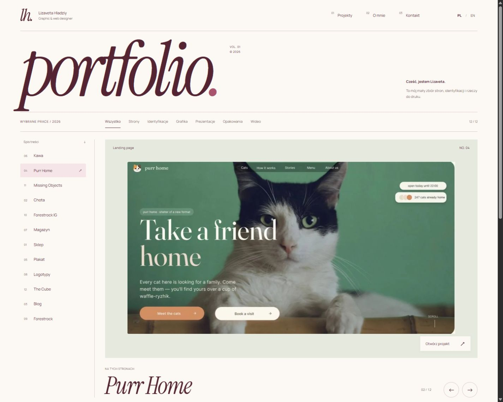
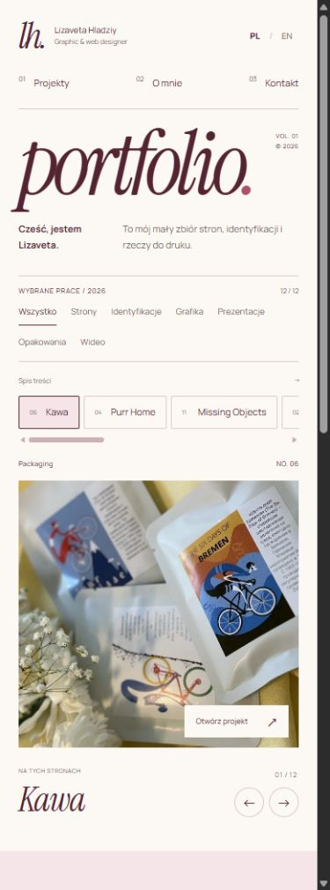

# Portfolio catalogue — verification

Verified locally on 2026-10-26.

## Design and behaviour

The homepage presents the work directly: a typographic masthead, a numbered contents list and one large selected project. Previous/next buttons browse the current category; clicking the preview opens its complete case study. On phones, the contents become a horizontally scrolling row, and the active item stays visible when using the arrows.

Instrument Serif and Manrope are self-hosted under their included OFL licenses. Warm paper, blush and burgundy tie the catalogue, monogram, biography and contact sections together. The decorative signature and its caption have been removed. There are no generated illustrations in the final site.

The original 12 project records and their full media/gallery order remain unchanged. Existing CNAME, PDF and video are retained. Overview images are larger optimized WebPs for the large preview; all 11 files together are about 807 KB, with only the selected preview requested on load.

## Validation

- JavaScript syntax and Git whitespace checks pass.
- PL and EN at 320, 390, 768, 1024 and 1440 pixels: no horizontal page overflow or empty translations.
- Filters: websites 3, identity 2, graphics 4, presentations 1, packaging 1, video 1, all 12. A filter keeps keyboard focus and synchronizes the selected preview with its index. Browsing arrows disable for a single result.
- All 12 index entries open their matching project. Image gallery counts: 4, 6, 4, 3, 7, 3, 1, 2, 8, 3 and 4, plus the existing Forestrock video.
- Mobile Purr Home image enlargement loads the original file. Escape closes the image dialog first, returning focus to its gallery button; a second Escape closes the project, returns focus to the preview and releases scroll locking.
- Next/previous browsing updates the title, position and active index. Mobile index scrolling keeps the selected entry visible.
- No browser console errors or warnings during these checks.
- Text colours meet WCAG AA normal-text contrast on the paper and pink backgrounds (muted text is at least 4.86:1; primary text on pink is 10.29:1).

These are local branch checks. Publication requires merging the PR and successful GitHub Pages deployment.

## Previews

