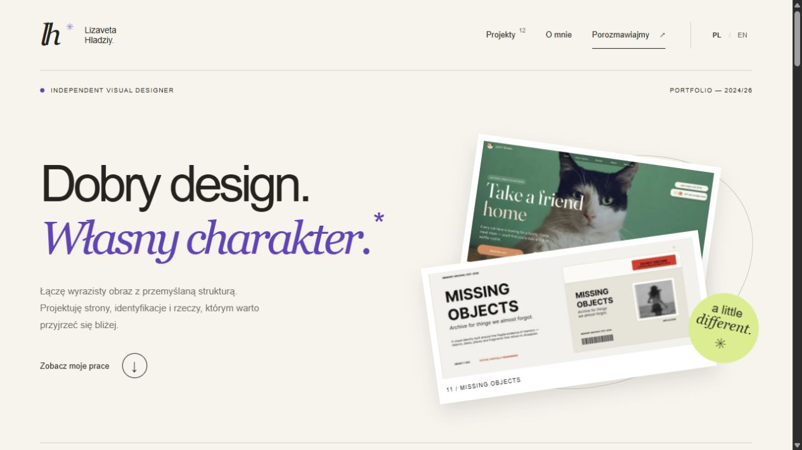

# Editorial portfolio redesign — verification

Verified locally on 2026-10-26 in the Codex Chromium browser. This is local verification, not confirmation of a public deployment.

## Direction

Warm paper, ink, violet typography, lime accents and a monogram. A collage introduces real work; an asymmetric image grid replaces the sidebar selector. All twelve projects remain accessible through category filters and native project dialogs. The about and contact sections use the same typography and spacing system.

## Content integrity

- The complete `projectData` object compares identically to the previous `index.html` after JSON serialization, including all Polish/English descriptions and image ordering.
- All 46 referenced original media files exist. Original files, PDFs and `CNAME` are unchanged.
- Eleven overview thumbnails total 463,292 bytes; full galleries retain original assets.
- Chota continues to hide its external-site button; Forestrock retains its website link and video.

## Verification

- `node --check app.js`, `node --check projects.js`, `git diff --check`: passed.
- Opened each of the twelve projects in the browser: expected gallery counts 4, 4, 6, 3, 7, 3, 1, 2, 8, 3, 4, and one video.
- Web filter displays Purr Home, Chota and Store; Video filter displays Forestrock. Filter buttons retain focus after selection.
- PL/EN changes page content, filters and project metadata. English preference survives reload.
- Enlarging Missing Objects opens the correct original; Escape closes only the top image dialog and restores focus to the thumbnail. Closing a project restores focus to its card.
- Video controls, metadata loading, website link and pause-on-close checked. No autoplay. A single-project category hides Next.
- Polish viewport checks at 320, 390, 768, 1024 and 1440 pixels: no horizontal overflow. English checks at 320, 768 and 1440 pixels: no horizontal overflow.
- Mobile Purr Home dialog: six images, no internal horizontal overflow.
- No browser console errors/warnings or broken loaded overview images were reported.
- CSS disables smooth scrolling/transitions for reduced-motion preferences. Native dialogs handle focus trapping, inert background and Escape; visible focus styles and a skip link are provided.

External email delivery, LinkedIn and end-to-end video playback were not exercised. The public site is unchanged until this branch is merged and GitHub Pages deploys it.

## Screenshots

Desktop, default browser viewport:

Work overview:

Mobile, 390 × 844:

