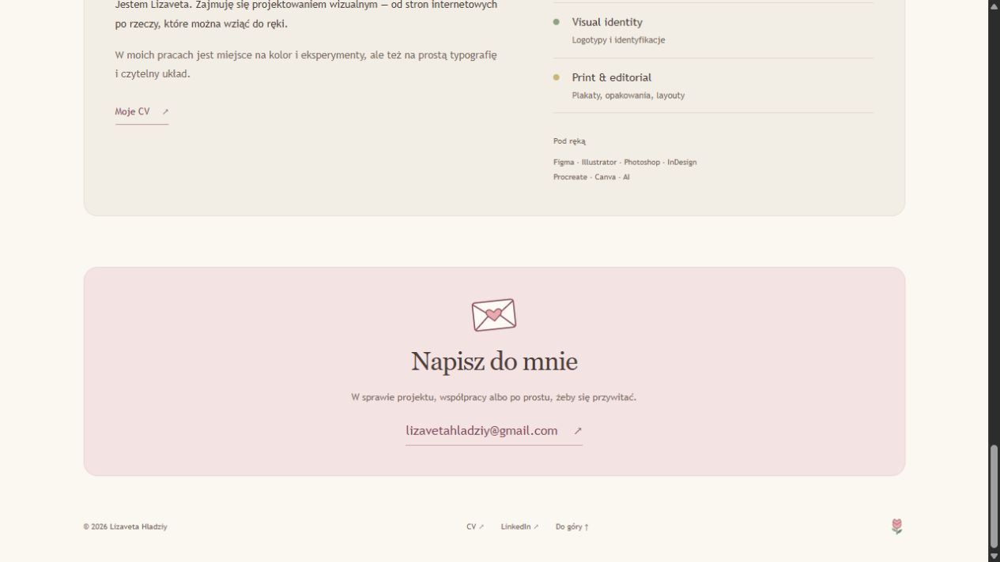

# Personal tulip identity — verification

Verified locally on 2026-10-26. This revision replaces the editorial direction from PR #1 with a softer personal portfolio, following the owner's feedback.

## Design

Cream paper, berry text, dusty pink and sage accents. A custom SVG tulip appears in the wordmark, favicon and footer; a matching notebook illustration and envelope detail give the site a consistent personal identity. Smaller, non-italic headings, direct PL/EN copy and an equal two-column gallery replace the oversized typography, rotated project collage and slogans.

No new dependencies, external assets or font requests. The original project data, gallery order within each project, media, PDFs and domain remain unchanged. Purr Home now leads the overview.

## Checks

- `node --check app.js`, `node --check projects.js`, `git diff --check`: passed.
- PL and EN, each at 320, 390, 768, 1024 and 1440 pixels: no horizontal overflow; no empty translation fields.
- Visually checked the mobile introduction at 320 and 390 pixels, and desktop introduction, work grid and contact section.
- All filters: websites 3, identity 2, graphics 4, presentations 1, packaging 1, video 1, all 12.
- Mobile Purr Home gallery: all six images, no internal overflow. Image enlargement uses the original PNG. Escape closes the top dialog and returns focus; project close returns focus to the card and releases scrolling.
- No console errors or warnings during these checks.
- Project descriptions and original files are unchanged. Existing video, language persistence and external-link behaviour remain in the retained interaction code; their previous checks are documented in the Git history.

These checks verify the local branch. Publication requires merging the corresponding PR and completion of GitHub Pages deployment.

## Previews

